# Microsoft Configuration Manager (SCCM) Lab

This project covers the setup and configuration of Microsoft Configuration Manager (SCCM) in a Hyper-V environment, integrated with Active Directory, SQL Server and Windows 11.

The lab includes SCCM Primary Site installation, client discovery and deployment, boundary and device collection configuration, software deployment, and Group Policy management.

It also documents several issues encountered during the setup, including SQL Server connectivity problems and SCCM client installation failures, along with the troubleshooting steps and solutions.

<p align="center">
  <a href="images/lab-topology.png">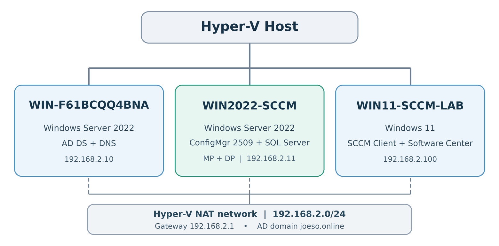</a>
</p>

| Machine | What it's used for | IP address |
| --- | --- | --- |
| `WIN-F61BCQQ4BNA` | Domain Controller: Active Directory and DNS (`joeso.online`) | `192.168.2.10` |
| `WIN2022-SCCM` | Configuration Manager, SQL Server, Management Point and Distribution Point | `192.168.2.11` |
| `WIN11-SCCM-LAB` | Windows 11 test computer | `192.168.2.100` |
| Hyper-V NAT gateway | Internet access for the VMs | `192.168.2.1` |

- Hyper-V lab network: `192.168.2.0/24`
- AD domain: `joeso.online`
- SCCM version: Configuration Manager 2509
- Primary site code: `S01`
- Site name: `SCCM Lab`
- Windows Server: 2022 with Desktop Experience
- SQL Server: 2022 Developer Edition

The Hyper-V NAT subnet is separate from my home network (`192.168.1.0/24`). The domain-joined computers use the DC (`192.168.2.10`) for DNS. External DNS requests can be forwarded by the DC.

## How the SCCM setup works

Microsoft Configuration Manager (SCCM) is Microsoft's software for managing company computers from one place. It includes software on the server, a client installed on each managed PC, a database, and a console for IT administrators.

In this lab, I set up **one Primary Site**, called `S01`. The site is the part of SCCM that manages the client computers. It uses a **Site Server** to run its background services and a **SQL Server database** to hold device records, settings and deployment results.

For this lab, the Site Server, SQL Server, Management Point and Distribution Point all run on `WIN2022-SCCM`. They do different jobs, even though they are on the same VM. Active Directory and DNS run separately on `WIN-F61BCQQ4BNA`.

### The main parts

| Part | What it does |
| --- | --- |
| **Configuration Manager** | The whole software system used to manage the PCs. |
| **Primary Site (`S01`)** | The main management unit for the PCs in this lab. |
| **Site Server** | The Windows server running the site's main services. |
| **SQL Server** | Stores device details, settings and deployment results. |
| **Management Point (MP)** | The contact point for SCCM clients. Clients request policies and content locations from it and send information back through it. |
| **Distribution Point (DP)** | Holds software files that clients download for installation. |
| **SCCM Client** | Runs on each managed PC, carries out tasks and reports the results. |
| **Configuration Manager Console** | The program IT administrators use to manage the site. It connects through the **SMS Provider**, rather than working directly with the SQL database. |

The **Console is not the Site itself**. Closing the Console does not stop the site or its clients from working. Also, a computer being joined to the AD domain does not automatically mean it has the SCCM client installed.

### How a software deployment works

Here is the full process I tested with 7-Zip:

1. **Find the PC.** SCCM discovers `WIN11-SCCM-LAB` from Active Directory. At this stage it is only a device record in the Console.
2. **Install the client.** I use Client Push to install the SCCM client on the Windows 11 PC and assign it to site `S01`.
3. **Choose the target.** I add the PC to a **Device Collection**, then deploy 7-Zip to that collection.
4. **Prepare the files.** SCCM makes the 7-Zip installer available on the **Distribution Point**.
5. **Run the deployment.** The Windows 11 client contacts the **Management Point** for its policy, finds a suitable DP for its network, downloads the installer, and installs 7-Zip.
6. **Check the result.** The client sends its status back to SCCM. I can see the result in the Console.

This is why SCCM needs several parts: the site manages the job, the MP handles client communication, the DP supplies the files, and the client does the work on the PC.

### Boundary, Boundary Group and Device Collection

These three objects serve different purposes:

| Object | What it actually is | What it is used for |
| --- | --- | --- |
| **Boundary** | A definition of a network location, such as an IP range. It is **not** a list of PCs. | Identifies which network a client is using. |
| **Boundary Group** | One or more boundaries linked to SCCM site systems. | Helps clients find suitable resources, especially DPs. It can also be used for automatic site assignment. |
| **Device Collection** | A list of device records selected by membership rules. | Chooses which PCs receive applications, updates or other deployments. |

In this lab, the Boundary covers `192.168.2.1–192.168.2.254`. The Boundary Group `SCCM-Lab-BG` links that network to site `S01` and the DP on `WIN2022-SCCM`. The Device Collection `SCCM Lab Clients` contains the Windows 11 test PC.

**Boundary Groups and Collections work independently.** The Boundary Group helps the client find resources based on its network. The Collection determines whether it is included in a deployment. I specified site `S01` during Client Push, so the client did not need to rely on automatic site assignment to choose the site.

### What about more servers or sites?

A Primary Site can use MPs and DPs on other servers. For example, a company can keep one Primary Site and put DPs in different offices to provide local software downloads. Adding another DP does **not** create another Primary Site.

A **Secondary Site** is an optional site connected to a Primary Site, sometimes used to control communication with a remote office over a limited network connection. It has its own site database (often SQL Server Express), but clients remain assigned to the parent Primary Site. A **Central Administration Site (CAS)** is used to manage a hierarchy with more than one Primary Site. Neither is needed for this lab.

## 1. Prepare the SCCM server

I prepared a Windows Server 2022 VM, named it `WIN2022-SCCM`, and joined it to `joeso.online`.

I used the following software and Windows features:

| Item | What I installed or set |
| --- | --- |
| SQL Server 2022 Developer | Database Engine Services, default instance (`MSSQLSERVER`) |
| SQL collation | `SQL_Latin1_General_CP1_CI_AS` |
| SQL authentication | Windows Authentication |
| SQL memory | Minimum and maximum server memory set to `8192 MB` in SSMS |
| SQL network | TCP/IP enabled, static TCP port `1433` |
| IIS | Web Server with SCCM-related features including Windows Authentication and ISAPI Extensions |
| Windows features | .NET Framework 3.5, Remote Differential Compression, BITS and BITS IIS extension |
| Windows ADK | Deployment Tools and USMT |
| Windows PE | Installed the WinPE add-on separately |
| SQL ODBC driver | ODBC Driver 18, eventually changed to version `18.6.2.1` after a connection problem |

<p align="center">
  <a href="images/sql-collation.png">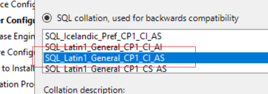</a>
</p>

A couple of settings were important:

- **SQL collation:** I had to change the default collation to `SQL_Latin1_General_CP1_CI_AS` before installing SQL Server.
- **SQL service account:** SCCM's prerequisite checker rejected the original `NT SERVICE\MSSQLSERVER` account. For this lab I changed the SQL Server Database Engine service to the built-in **Network Service** account, using SQL Server Configuration Manager, and ran the check again.

I didn't set up the AD `System Management` container or extend the AD schema. These can be added later. For this lab I specified the SCCM site when installing the client.

## 2. Install the SCCM Primary Site

I extracted the Configuration Manager installer and started Setup using `splash.hta`.

In the wizard I chose:

| Setting | Value |
| --- | --- |
| Installation type | Stand-alone Primary Site (typical installation) |
| Site code | `S01` |
| Site name | `SCCM Lab` |
| SQL Server | Local SQL Server on `WIN2022-SCCM` |
| Console | Installed on the SCCM server |
| Management Point (MP) | On `WIN2022-SCCM` |
| Distribution Point (DP) | On `WIN2022-SCCM` |

I saved the setup prerequisite downloads in a local folder. The folder had to exist first; Setup would not create it from the path I entered.

After fixing the prerequisite errors and the later SQL connection issue, I could open the Configuration Manager Console and see site `S01`. Under **Administration > Site Configuration > Servers and Site System Roles**, the MP, DP, SMS Provider and other site roles appeared.

<p align="center">
  <a href="images/site-system-roles.png">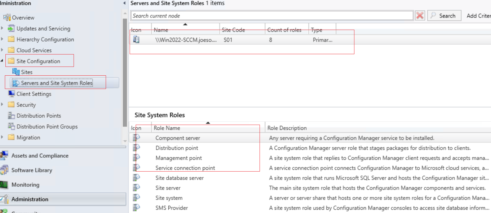</a>
</p>

### What the main SCCM parts do

| Component | My simple understanding |
| --- | --- |
| Primary Site | The SCCM site that manages the computers |
| SQL Server | Stores device information, settings and deployment status |
| Management Point (MP) | Tells SCCM clients what to do and receives their reports |
| Distribution Point (DP) | Holds the software installation files for clients to download |
| SMS Provider | Connects the SCCM Console to the site information through WMI |
| SCCM Client | Runs on the PC, gets the policy, installs the software and reports back |

For example, when I deploy 7-Zip, the client gets the instruction through the MP but downloads the MSI from the DP.

## 3. Boundary and Boundary Group

I set up the network location in SCCM before installing the client. The Boundary defines the IP range; the Boundary Group links it to site `S01` and the Distribution Point.

### Boundary

In **Administration > Hierarchy Configuration > Boundaries**, I created an **IP address range** boundary:

| Setting | Value |
| --- | --- |
| Name/description | `SCCM Lab Network` |
| Starting IP | `192.168.2.1` |
| Ending IP | `192.168.2.254` |

<p align="center">
  <a href="images/boundary.png">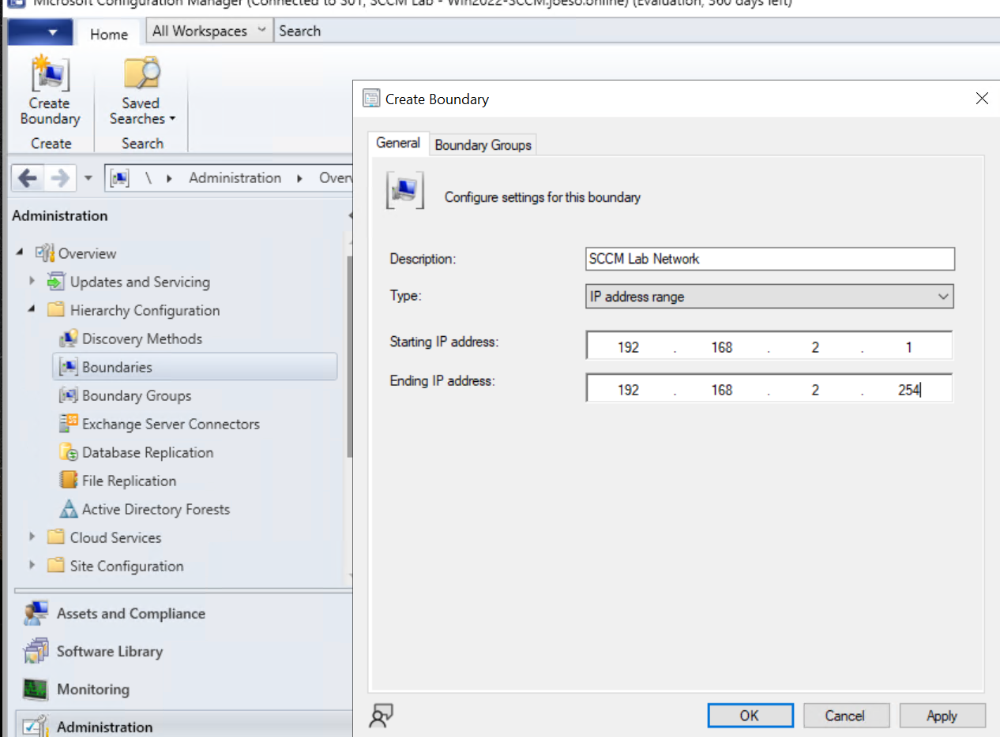</a>
</p>

### Boundary Group

In **Administration > Hierarchy Configuration > Boundary Groups**, I created `SCCM-Lab-BG`.

I added the boundary above, enabled site assignment to `S01` and added `WIN2022-SCCM.joeso.online` as the site system server.

<p align="center">
  <a href="images/boundary-group-references.png">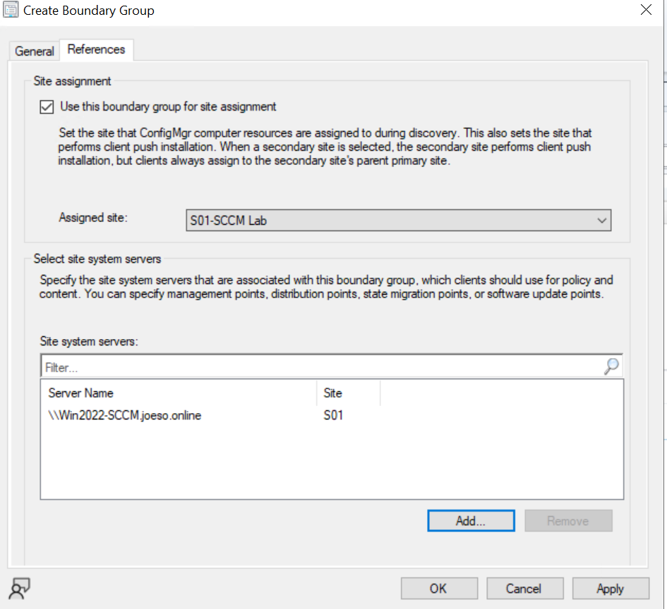</a>
</p>

The Boundary is only a network definition. By adding it to a Boundary Group, I linked that network to the available SCCM resources.

## 4. Discover the Windows 11 PC

I used **Active Directory System Discovery** so the Windows 11 PC would appear in the SCCM Console before I pushed the client.

1. Open **Administration > Hierarchy Configuration > Discovery Methods**.
2. Open **Active Directory System Discovery > Properties** and enable it.
3. Add `joeso.online` as the search location and include child containers.
4. Run **Full Discovery Now**.
5. Go to **Assets and Compliance > Devices** and find `WIN11-SCCM-LAB`.

<p align="center">
  <a href="images/ad-system-discovery.png">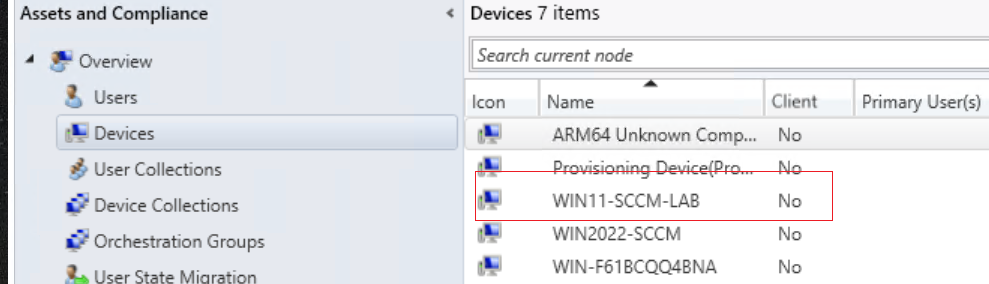</a>
</p>

At first, the device showed **Client = No**, which was expected because the SCCM client had not been installed yet.

## 5. Install the SCCM client using Client Push

I wanted SCCM to install the client remotely rather than running the installer on Windows 11 myself.

In **Administration > Site Configuration > Sites**, I opened **Client Installation Settings > Client Push Installation** and added a client push account. For this isolated lab I used my domain administrator account (`JOESO\Administrator`). In a real company I'd use a dedicated account with local admin rights on the workstations instead of Domain Admin.

Then:

1. Go to **Assets and Compliance > Devices**.
2. Right-click `WIN11-SCCM-LAB` > **Install Client**.
3. Choose **Install the client software from a specified site** and select `S01`.
4. Complete the wizard.

<p align="center">
  <a href="images/client-push-options.png">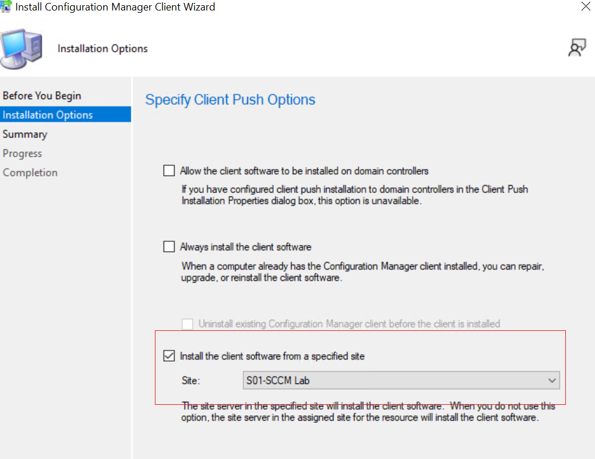</a>
</p>

### The first push failed

In the server log `ccm.log`, I found:

```text
NetUseAdd failed: 53
Unable to access target machine
```

SCCM was trying to reach the Windows 11 administrative share:

```text
\\WIN11-SCCM-LAB\admin$
```

`ADMIN$` is the built-in share pointing to the remote computer's Windows folder. SCCM uses SMB and remote management to copy files and start the client installer.

<p align="center">
  <a href="images/admin-share-network-error.png">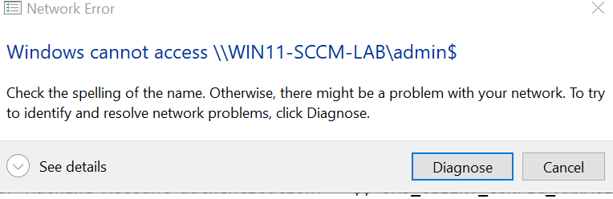</a>
</p>

I checked the client firewall and allowed the needed **File and Printer Sharing (SMB-In)** and **WMI** traffic. I also checked that the account could access `ADMIN$`. Once network access and authentication worked, the push request completed successfully.

The end of `ccm.log` showed:

```text
sp_CP_SetLastErrorCode ... 0
Completed request ... WIN11-SCCM-LAB
```

On the Windows 11 machine I could check `C:\Windows\CCM` and **Control Panel > Configuration Manager**. The SCCM Console eventually showed **Client = Yes**.

## 6. Create a Device Collection

I created a collection so I could deploy software only to my Windows 11 test PC.

In **Assets and Compliance > Device Collections > Create Device Collection**:

| Setting | Value |
| --- | --- |
| Collection name | `SCCM Lab Clients` |
| Limiting collection | `All Systems` |
| Membership rule | Direct rule |
| Resource class | System Resource |
| Attribute | Name |
| Value | `WIN11-SCCM-LAB` |

After creating it, I checked that the Windows 11 PC appeared under **Show Members**.

<p align="center">
  <a href="images/device-collection.png">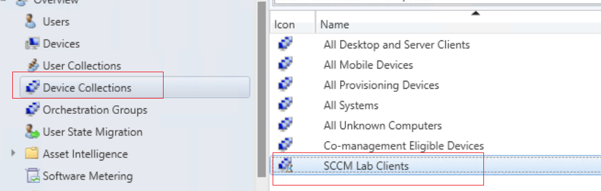</a>
</p>

The difference from a Boundary Group is important: a **Device Collection chooses which PCs receive a deployment**. A **Boundary Group helps those PCs find the right site and download location**.

## 7. Deploy 7-Zip through SCCM

I used an MSI installer for 7-Zip and created a **Required** deployment. I wanted to see whether SCCM would install it automatically without me clicking Install on Windows 11.

### Prepare the files

I downloaded the 7-Zip x64 MSI and put it in a source folder such as:

```text
C:\SCCMSource\7Zip
```

I shared the source folder as `SCCMSource` and gave the SCCM server computer account read access, with NTFS permissions as well. The application source path is a UNC path, for example:

```text
\\WIN2022-SCCM\SCCMSource\7Zip\<7zip-installer>.msi
```

The client does **not** need direct access to this share. The SCCM Distribution Point provides the content to clients.

### Create the application

1. Go to **Software Library > Application Management > Applications**.
2. Right-click **Applications > Create Application**.
3. Choose automatic detection from a **Windows Installer (.msi)** file.
4. Browse to the MSI using its UNC path.
5. Let SCCM read the MSI details.
6. Check the Deployment Type and its **MSI Product Code** detection method.
7. Use **Install for system**, whether or not a user is logged on.

The MSI Product Code detection rule lets SCCM check whether this version of 7-Zip is already installed.

<p align="center">
  <a href="images/create-application.png">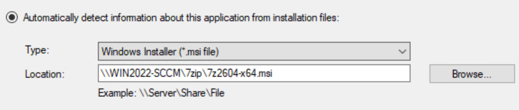</a>
</p>

### Distribute and deploy

**Distribute Content** copies the installer to the DP. **Deploy** says which PCs should receive it. I used the Deploy wizard, which can also add the DP as a content destination.

1. Right-click the **7-Zip** application > **Deploy**.
2. Choose **Device Collections > SCCM Lab Clients**.
3. Under Content, add the DP on `WIN2022-SCCM`.
4. Set **Action = Install** and **Purpose = Required**.
5. Set the software available time and installation deadline to **As soon as possible**.
6. Keep the application visible in Software Center.
7. Finish the wizard.

<p align="center">
  <a href="images/required-deployment.png">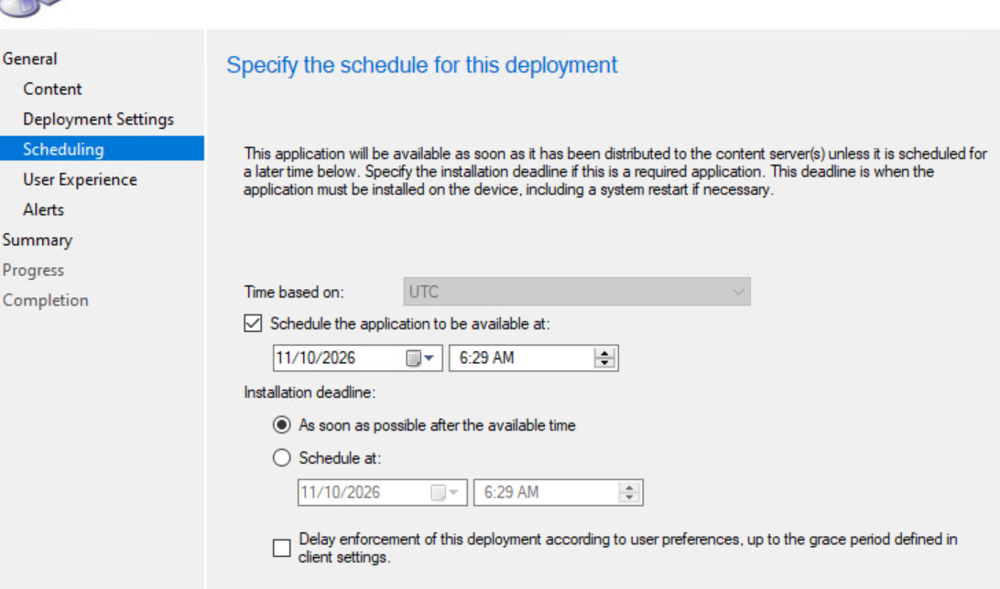</a>
</p>

**Required vs Available:**

- **Required** means SCCM installs the application automatically when the deadline and conditions allow it.
- **Available** means the application is shown in Software Center and the user can choose Install.

For my test I used **Required**. I didn't want to manually start a policy retrieval cycle, because I wanted to test the normal automatic deployment process.

### Check the result

On SCCM:

- **Monitoring > Distribution Status > Content Status** checks whether the files reached the DP.
- **Monitoring > Deployments > 7-Zip > View Status** checks whether the client actually installed or detected the application.

These are two different results. Files reaching the DP doesn't mean installation on the PC is complete.

<p align="center">
  <a href="images/deployment-success.png">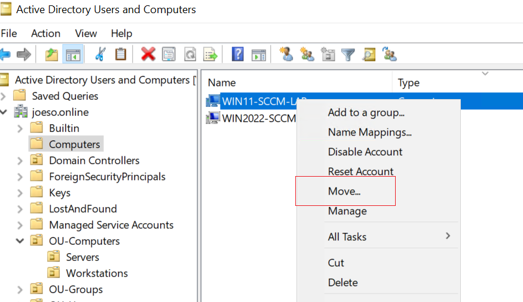</a>
</p>

On Windows 11 I checked **Software Center** and **Settings > Apps > Installed apps**. My lab notes show the 7-Zip deployment reporting **Success** for `WIN11-SCCM-LAB`.

## 8. Set up client push firewall rules using Group Policy

I also worked on a GPO so I wouldn't need to enable Windows Firewall rules by hand on every new PC.

I placed `WIN11-SCCM-LAB` in the `Workstations` OU and created/linked an SCCM client firewall GPO there.

In **Group Policy Management**, I edited:

```text
Computer Configuration
  > Policies
  > Windows Settings
  > Security Settings
  > Windows Defender Firewall with Advanced Security
  > Inbound Rules
```

<p align="center">
  <a href="images/gpo-firewall-rules.png">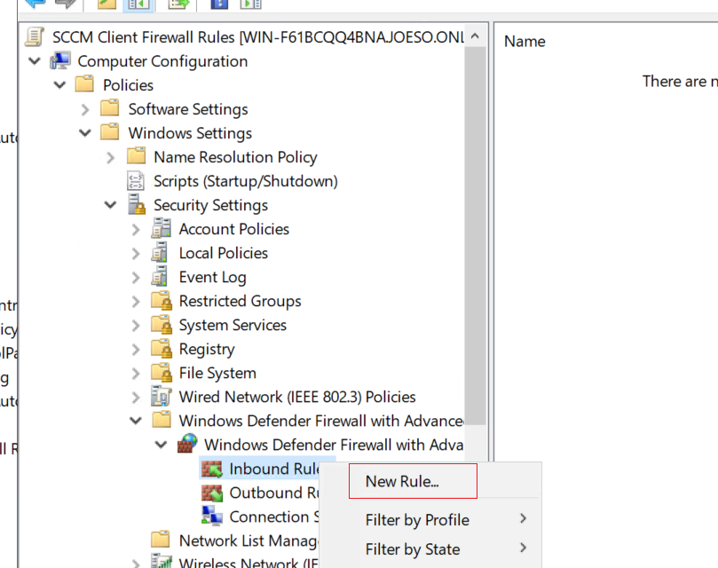</a>
</p>

I configured the relevant predefined rules:

| Rule | Why |
| --- | --- |
| File and Printer Sharing (SMB-In) | Allows access to `ADMIN$` over TCP 445 |
| Windows Management Instrumentation (WMI-In / DCOM-In) | Allows remote WMI communication |
| Remote Service Management (RPC / RPC-EPMAP) | Supports remote service management |

I restricted the new rules to the **Domain** profile and remote IP `192.168.2.11` (my SCCM server).

<p align="center">
  <a href="images/firewall-source-ip.png">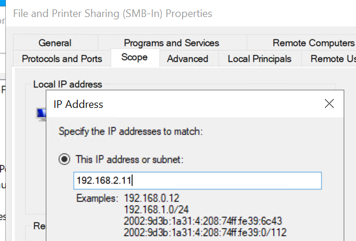</a>
</p>

This GPO is for **installing the SCCM client remotely**. Once a client is installed, normal SCCM application deployments mainly use outbound connections to the MP and DP, so this inbound firewall GPO is not what delivers 7-Zip.

## 9. Troubleshooting

These three issues came up during setup and client deployment. I kept the errors and the steps that resolved them for future reference.

### Issue 1 – SCCM setup failed the SQL Server service account check

**What happened**

During the SCCM prerequisite check, I got **Failed** for **SQL Server service running account**. SQL Server was running under its default virtual service account:

```text
NT SERVICE\MSSQLSERVER
```

The SCCM setup check did not accept that account for the SQL Server service.

<p align="center">
  <a href="images/sql-service-account-prerequisite.png">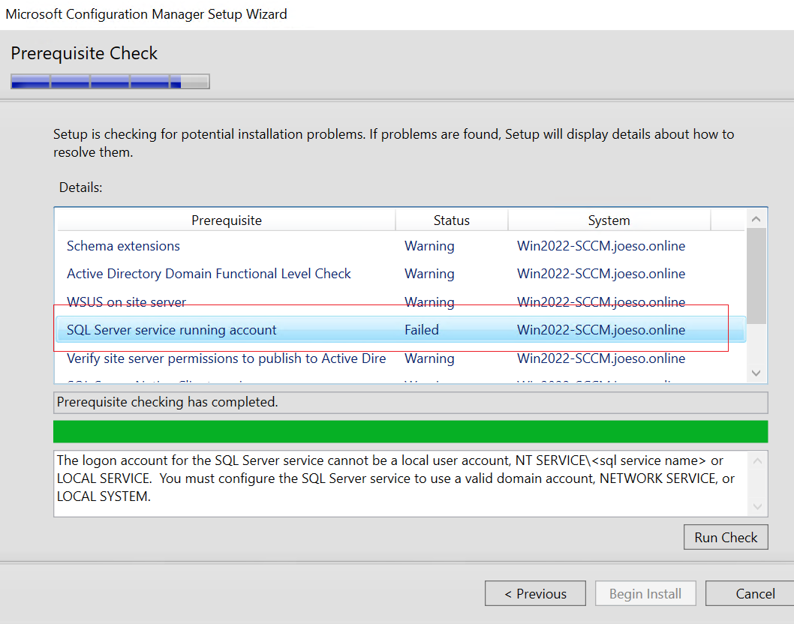</a>
</p>
**What I did**

1. On `WIN2022-SCCM`, I opened **SQL Server 2022 Configuration Manager**.
2. Under **SQL Server Services**, I opened **SQL Server (MSSQLSERVER) > Properties > Log On**.
3. I changed the service account to the built-in **Network Service** account.
4. I applied the change and restarted the SQL Server service from SQL Server Configuration Manager.
5. I went back to SCCM Setup and clicked **Run Check** again.

**Result:** The blocking check was cleared and I could continue with the Primary Site installation.

I learned that the SQL Server service can run normally under one account, but SCCM setup may still require a different account. `NETWORK SERVICE` was fine for this lab; I would check Microsoft's current account recommendations before doing the same thing in production.

### Issue 2 – SCCM installed, but the Console could not connect

**What happened**

The SCCM setup wizard finished, but when I tried to open the Console I got this message:

```text
Configuration Manager cannot connect to the site
(Win2022-SCCM.joeso.online)
```

<p align="center">
  <a href="images/sccm-console-connection-error.png">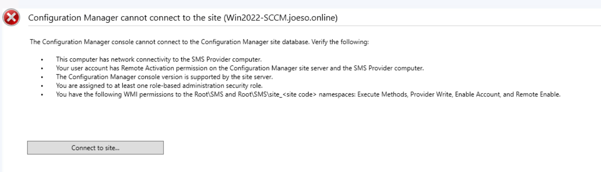</a>
</p>

I checked Windows Services. `SMS_SITE_COMPONENT_MANAGER` was running, but `SMS_EXECUTIVE` was missing. So even though the installer had finished its main steps, the SCCM site components were not working properly yet.

I opened this log on the SCCM server:

```text
C:\Program Files\Microsoft Configuration Manager\Logs\sitecomp.log
```

It repeatedly showed:

```text
Failed to connect to the SQL Server, connection type: SMS ACCESS.
Failed to read site information from database, retry in 5 seconds ...
```

This pointed me towards the SQL connection rather than a Console-only problem.

**What I did**

1. I checked the SQL Server service and the SQL-related drivers installed on `WIN2022-SCCM`.
2. I found **Microsoft ODBC Driver 18 for SQL Server – 18.7.1.1**.
3. That driver version was causing a compatibility problem with this SCCM setup.
4. I replaced it with **ODBC Driver 18.6.2.1** and restarted the SCCM server.
5. I reopened Configuration Manager Console.

<p align="center">
  <a href="images/odbc-18-7-installed.png">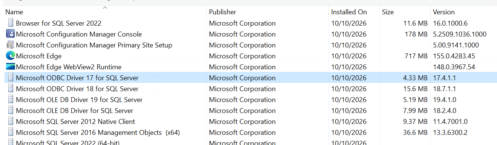</a>
</p>

<p align="center">
  <a href="images/odbc-18-6-installed.png">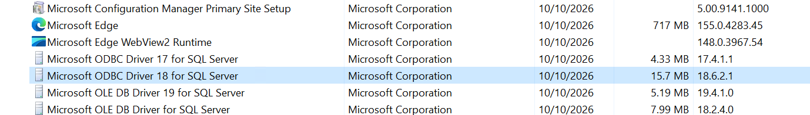</a>
</p>

**Result:** The Console connected to site `S01`, and I could see the Site Server, MP, DP, SMS Provider and other site roles.

The useful clue was in `sitecomp.log`. The issue was with the site's SQL connection, not simply the Console. Checking the log saved me from reinstalling the wrong component.

### Issue 3 – Client Push failed with Error 53

**What happened**

After AD System Discovery, `WIN11-SCCM-LAB` appeared in SCCM, but **Client = No**. I tried **Install Client**, but it did not install.

On the SCCM server, I checked:

```text
C:\Program Files\Microsoft Configuration Manager\Logs\ccm.log
```

These lines were the important ones:

```text
Warning: no remote client installation account found
Attempting to connect to administrative share
'\\WIN11-SCCM-LAB\admin$' using machine account
NetUseAdd failed: 53
Unable to access target machine ... access denied or invalid network path
```

The error happened when SCCM tried to reach `ADMIN$`, a hidden Windows share that points to `C:\Windows` on the remote PC. Client Push needs this connection to copy files and start the installer remotely.

I tested the share from the SCCM server:

```text
\\WIN11-SCCM-LAB\admin$
\\192.168.2.100\admin$
```

At first the network path failed. After allowing the connection I reached a Windows credential prompt, so I also had to make sure I was using an account with administrator access on the Windows 11 PC.

<p align="center">
  <a href="images/admin-share-network-error.png"></a>
</p>
**What I did**

1. On `WIN11-SCCM-LAB`, I opened **Windows Defender Firewall with Advanced Security** (`wf.msc`).
2. I enabled the required **File and Printer Sharing (SMB-In)** and **Windows Management Instrumentation** inbound rules for the Domain network.
3. I tested `\\192.168.2.100\admin$` again from the SCCM server and confirmed I could open it with administrator credentials.
4. In **SCCM Console > Administration > Site Configuration > Sites > Client Installation Settings > Client Push Installation > Accounts**, I added `JOESO\Administrator` as the Client Push account for this isolated lab.
5. I retried **Install Client** on `WIN11-SCCM-LAB`.

The later `ccm.log` showed:

```text
sp_CP_SetLastErrorCode 2097152001, 0
Completed request "2097152001", machine name "WIN11-SCCM-LAB"
```

**Result:** The Client Push request completed, and the SCCM Console showed **Client = Yes** for `WIN11-SCCM-LAB`.

This taught me to check two separate things when Client Push fails: **network access** (SMB/WMI/firewall/DNS) and **permissions** (which account SCCM is using). Being able to open `ADMIN$` with my own login doesn't automatically mean the SCCM push service is using that account.

Later, I used a **GPO on the Workstations OU** to set the client firewall rules automatically, so I wouldn't need to change the firewall by hand on every new PC. For a real company, I would use a dedicated push account with local administrator rights, not a Domain Admin account.

### Logs worth remembering

| Log | Where | What I check |
| --- | --- | --- |
| `sitecomp.log` | SCCM server, `C:\Program Files\Microsoft Configuration Manager\Logs` | Site components and SQL connection problems |
| `ccm.log` | SCCM server, same Logs folder | Client Push and `ADMIN$` connection errors |
| `ccmsetup.log` | Windows client, `C:\Windows\ccmsetup\Logs` | Whether the client installer started or failed |
| `PolicyAgent.log` | Windows client, `C:\Windows\CCM\Logs` | Whether the client got the deployment policy |
| `LocationServices.log` | Windows client, same folder | How it finds the MP and content locations |
| `CAS.log` | Windows client, same folder | Checking and caching application content |
| `AppDiscovery.log` | Windows client, same folder | Checking whether the application is already installed |
| `AppEnforce.log` | Windows client, same folder | Running the application installation |

I start with the log for the step that failed: site setup, Client Push, policy, content download or application installation.

<!-- Future additions, after the labs have been completed:
- Windows Update deployment through the Software Update Point / WSUS
- Hardware and software inventory / device information
-->
